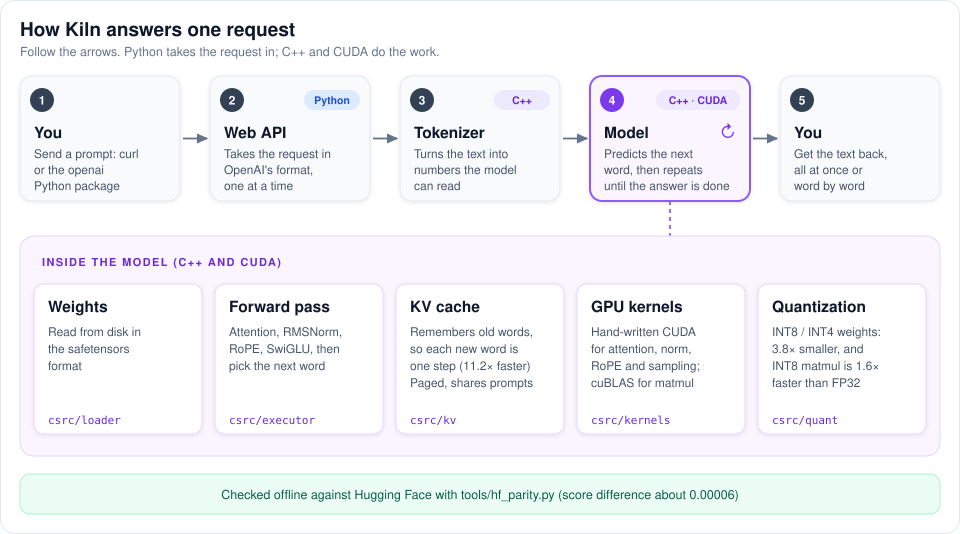

# Kiln

An LLM inference engine written from scratch. It loads a model's raw weights,
runs the forward pass in C++ (with hand-written CUDA kernels for the GPU), and
serves text completions over an OpenAI-compatible HTTP API. Python handles the
web layer; C++/CUDA does the math.

It's a learning project, not a production system. The goal was to build each
layer of an inference stack myself and check it against a reference instead of
assuming it works.

## How it fits together



## What's in it

| Piece | Where |
|---|---|
| Weight loading (safetensors) | `csrc/loader/` |
| Byte-pair-encoding tokenizer | `csrc/tokenizer/` |
| Forward pass: attention, RMSNorm, SwiGLU, RoPE, sampling | `csrc/executor/` |
| KV cache: contiguous, and paged with shared prefixes | `csrc/kv/` |
| INT8/INT4 quantization | `csrc/quant/` |
| LoRA: train an adapter, merge it into the weights | `tools/train_lora.py`, `tools/merge_lora_adapter.py`, `csrc/executor/lora.*` |
| CUDA kernels: attention, RMSNorm, RoPE, sampler, INT8 GEMM + dequant | `csrc/kernels/cuda/` |
| OpenAI-compatible API | `kiln_py/api/` |
| Hugging Face comparison | `tools/hf_parity.py`, `tools/tokenizer_conformance.py` |
| Perplexity scoring | `kiln_py/eval/perplexity.py` |

GEMM goes through cuBLAS on purpose; writing a faster one by hand isn't a good
use of time. The INT8 path uses cuBLAS integer matmul plus a custom dequantize
kernel.

## Results

**Real model, real GPU.** `SmolLM2-135M-Instruct` served through the HTTP API on
a GeForce GTX 1660 Ti: 219.2, 231.4 and 230.8 tok/s over 200-token runs
(wall-clock, including HTTP). One request at a time.

**Matches Hugging Face.** Final-logit difference against Hugging Face on 10
prompts is about 6×10⁻⁵ for both `SmolLM2-135M` and `SmolLM2-360M`. That's
FP32-vs-BF16 rounding.

**INT8 GEMM: 1.60× faster than FP32** on the same GPU
(`kiln_int8_gemm_cuda_benchmark`: 0.489 ms vs 0.305 ms). This card has no INT8
tensor cores, so the gain is smaller than a datacenter GPU would show.

**CPU benchmark** (`PYTHONPATH=. python3 bench/run_benchmarks.py`, small
randomly initialized model, so it measures speed, not quality):

| Optimization | Result |
|---|---|
| KV cache vs recomputing every step | 11.2× faster decode |
| INT8 weights | 3.76× smaller, MSE 3.5×10⁻⁵ |

Latency, same model and fixed seed, p50 (the script prints p99 too, and
`--json FILE` saves everything): time to first token is about 1.7 ms with or
without the cache. Inter-token latency is about 0.06 ms with the cache and
about 2.6 ms for the no-cache baseline, because the baseline re-runs the whole
sequence every step. KV cache cost is 1,024 bytes per token for this model.

Both rows are timed runs. The paged KV cache (copy-on-write prefix sharing) is
covered by unit tests in `tests/cpp/kv/`, not by a benchmark.

## Limits

- The API serves one request at a time. There is no batching across requests.
- No multi-GPU support.
- Not deployed, no real users.

## Try it

One command runs everything: build, tests, benchmarks, the HTTP API, and the
Hugging Face comparison (it uses a cached SmolLM2-135M-Instruct if it finds one):

```bash
bash demo.sh
```

Or step by step:

```bash
brew install cmake ninja nlohmann-json icu4c pybind11   # macOS build deps

pip install -e ".[dev]"                                  # builds the C++ side
cmake -B build -G Ninja && cmake --build build
ctest --test-dir build --output-on-failure
python -m pytest tests/py

# Serve a real checkpoint (add KILN_DEVICE=cuda on a CUDA build)
KILN_CHECKPOINT_DIR=<path-to-checkpoint> uvicorn kiln_py.api.app:app
curl localhost:8000/v1/completions -d '{"prompt": "The capital of France is", "max_tokens": 20, "temperature": 0.0}'
```

Compare against Hugging Face: `pip install -e '.[oracle]'`, then
`PYTHONPATH=. python tools/hf_parity.py --model-dir PATH --prompts-file tools/fixtures/hf_parity_prompts.txt`.

## Layout

```
csrc/      C++/CUDA
kiln_py/   Python API and runtime
tests/     cpp/ (GoogleTest), py/ (pytest)
tools/     Hugging Face comparison, LoRA training and merging, quantizer cross-check
bench/     benchmarks (CPU script, and a GPU INT8 vs FP32 test)
assets/    the architecture diagram
demo.sh    runs everything in one command
```
